

# UNIVERSITÉ CHEIKH ANTA DIOP DE DAKAR

**École Supérieure Polytechnique**

**Département Génie Informatique**

**L3 GLSI A — Semestre 5 — 2026-2027**

## Services Réseaux Avancés

# Rapport de TP
### Mise en place du protocole SSH

**Réalisé par :**

Junias TIAMNANGG TIOGANG
&
Mame Diarra Bousso DIOUM

**Enseignant :** Dr. Keba GUEYE

**Date :** 15 Novembre 2026

---

## Introduction

Ce TP a pour objectif de comprendre comment utiliser le protocole SSH pour sécuriser l'accès à une machine distante. Nous avons travaillé avec deux machines virtuelles VirtualBox placées sur le même réseau grâce au mode d'accès par pont. La première, sous Ubuntu 24.04, joue le rôle de serveur et a pour adresse IP 192.168.1.146. La seconde, sous Debian 12, joue le rôle de client et a pour adresse IP 192.168.1.148.

## 1. Installation de ssh

Dans cette première partie, nous avons installé le serveur SSH sur la machine Ubuntu et vérifié son bon fonctionnement.

La commande `apt policy openssh-server` montre que le paquet est bien installé.

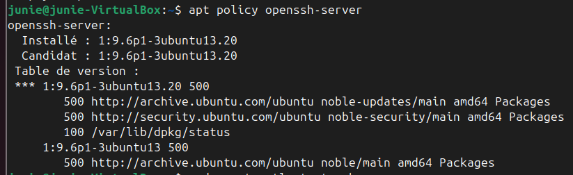

*Figure 1 : vérification de l'installation openssh-server*

La commande `service ssh status` indique que le service est active (running), c'est-à-dire en cours d'exécution.

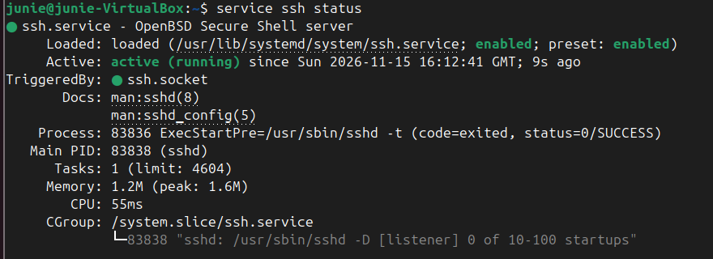

*Figure 2 : Service SSH actif*

Enfin, la commande `sudo netstat -anp | grep -w 22` montre que le processus ssh est à l'état LISTEN sur le port 22.

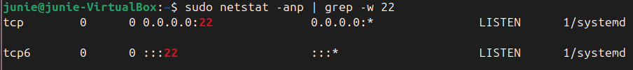

*Figure 3 : Port 22 en écoute*

Le serveur SSH est donc installé et actif, et il attend les connexions des clients sur le port 22, le port standard de SSH.

## 2. Connexion SSH depuis le client

Dans cette deuxième partie, nous nous sommes connectés au serveur depuis la machine cliente sous Debian.

Nous avons d'abord relevé l'adresse IP du serveur avec la commande `ip a`. L'interface enp0s3 a pour adresse 192.168.1.146, et c'est celle que nous avons utilisée.

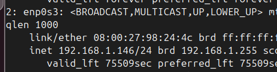

*Figure 4 : Adresse IP du serveur*

Depuis le terminal de la Debian, nous avons ensuite lancé la commande `ssh junie@192.168.1.146`. Le mot de passe de l'utilisateur junie a ensuite été demandé, puis saisi.

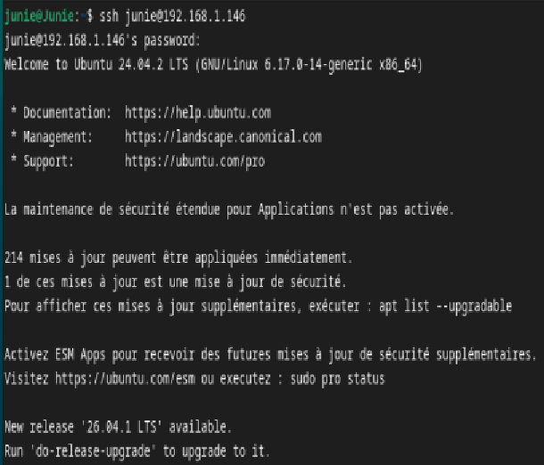

*Figure 5 : Connexion SSH reussie du client vers le serveur*

La connexion a réussi : le terminal affiche `junie@junie-VirtualBox:~$`, ce qui montre que nous contrôlons le serveur à distance depuis le client.

## 3. Configuration des clés SSH

Dans cette troisième partie, nous avons mis en place l'authentification par clé, qui permet de se connecter sans saisir de mot de passe.

Nous avons d'abord généré une paire de clés RSA sur le serveur Ubuntu. Avec `ls -a`, nous avons vérifié que le dossier caché `.ssh` avait été créé dans le répertoire personnel. Dans ce dossier, la commande `ls` affiche deux fichiers : `id_rsa`, la clé privée qui reste secrète sur le serveur, et `id_rsa.pub`, la clé publique qui peut être partagée.

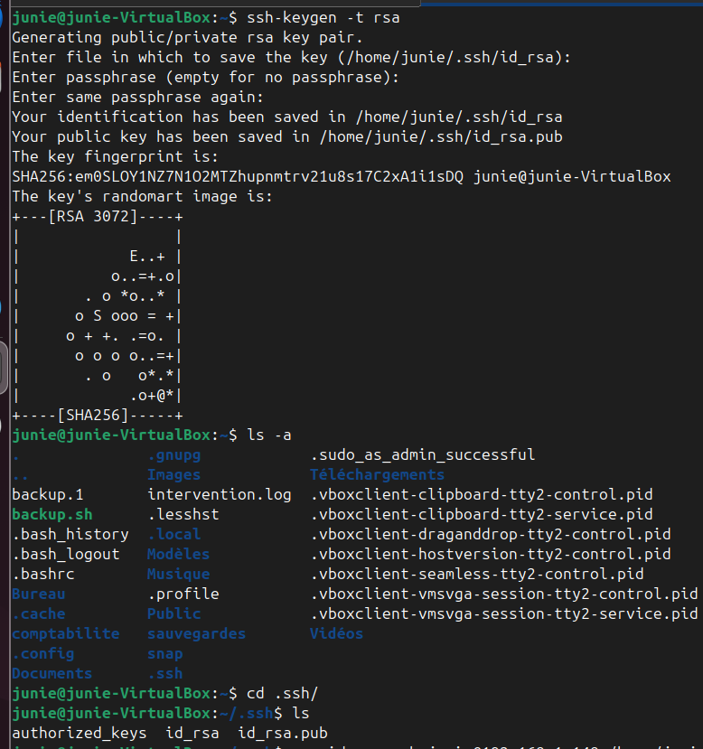

*Figure 6 : Génération de la paire de clés RSA sur le serveur*

Nous avons ensuite envoyé la clé publique du serveur vers la machine cliente Debian.

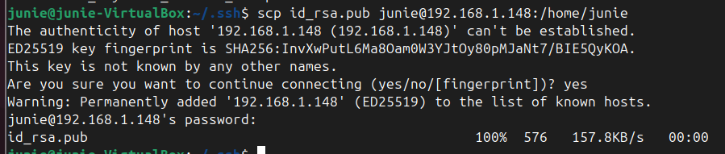

*Figure 7 : Envoi de la clé publique du serveur vers le client avec scp*

Pour que la clé soit acceptée, nous avons ajouté le contenu de `id_rsa.pub` dans le fichier `~/.ssh/authorized_keys` de la machine à laquelle on se connecte et réglé ses droits.

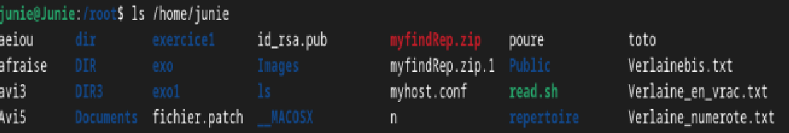

*Figure 8 : Présence du fichier id_rsa.pub sur le client Debian*

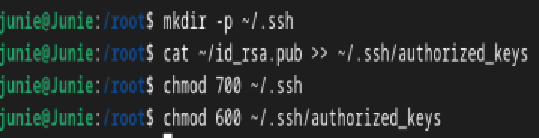

*Figure 9 : Ajout de la clé publique au fichier authorized_keys du client et réglage des droits*

Enfin, depuis le serveur, nous avons lancé `ssh junie@192.168.1.148`. La connexion à la Debian s'est faite sans demande de mot de passe, ce qui confirme que l'authentification par clé fonctionne

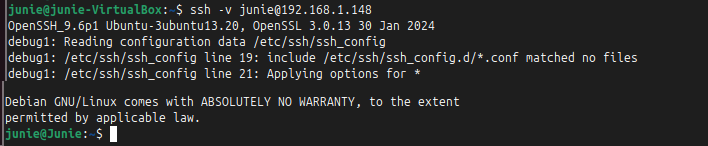

*Figure 10 : Connexion du serveur vers le client sans mot de passe*

## 4. Tunnel SSH

Dans cette dernière partie, nous avons utilisé un tunnel SSH pour accéder à un service du serveur à travers une connexion chiffrée. Les tests ont été faits depuis la Debian (client) vers l'Ubuntu (serveur).

**Test avec un serveur web :** Nous avons d'abord installé Apache sur le serveur avec `sudo apt install apache2`, puis vérifié avec `systemctl status apache2` qu'il était active (running).

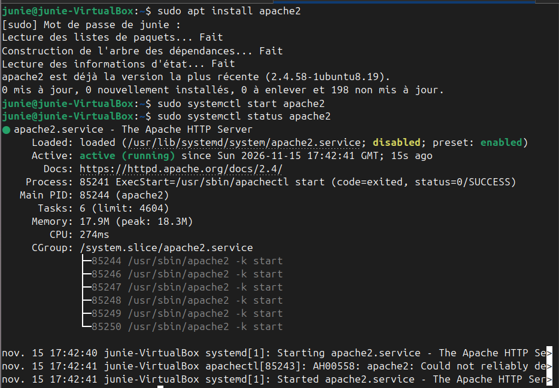

*Figure 11 : Service Apache actif sur le serveur*

Un serveur nginx occupait déjà le port 80. L'outil netstat a montré qu'Apache écoutait sur le port 8080 et non sur le port 80. Nous avons donc adapté la commande du tunnel en conséquence.

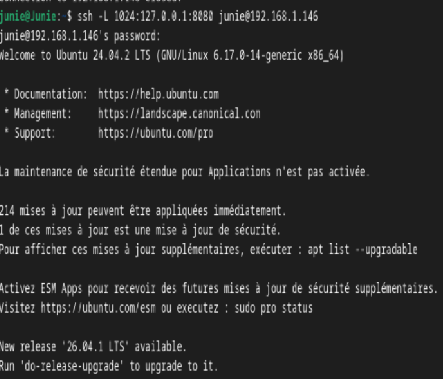

*Figure 12 : Création du tunnel SSH vers le port 8080 du serveur (port local 1024)*

Le terminal est resté ouvert pendant le test. Dans le navigateur de la Debian, l'adresse `http://127.0.0.1:1024` affiche une page d'Apache, dont le bas indique `Apache/2.4.58 (Ubuntu) Server at 127.0.0.1 Port 1024`.

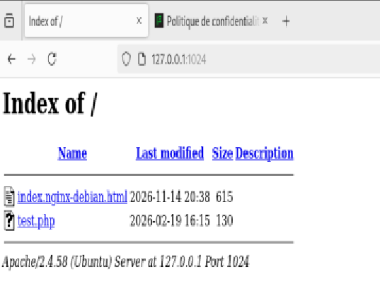

*Figure 13 : Page d'Apache affichée dans le navigateur du client via le tunnel*

Le test est réussi car une page du serveur a été atteinte à travers le tunnel SSH.

**Test avec une base de données :** Nous avons installé MariaDB sur le serveur avec `sudo apt install mariadb-server`. Le service est active (running) et écoute sur le port 3306

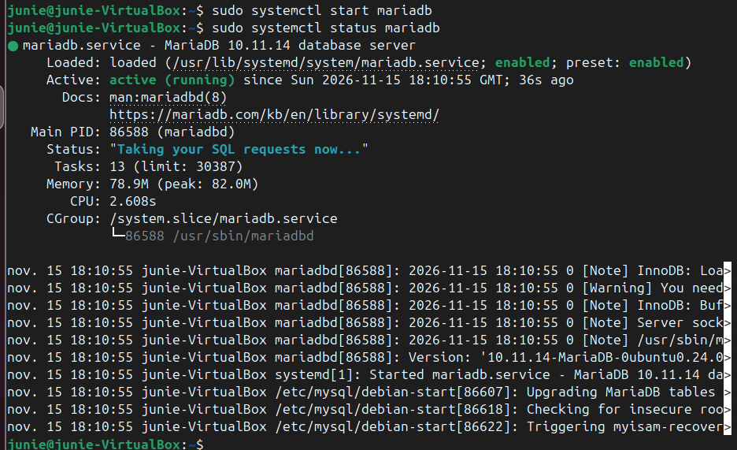

*Figure 14 : Service MariaDB actif sur le serveur*

Sous Ubuntu, l'utilisateur root de MariaDB ne peut pas se connecter par mot de passe. Nous avons donc créé un utilisateur de test nommé tp.

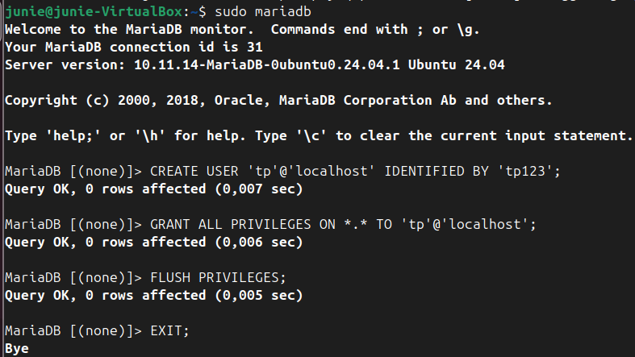

*Figure 15 : Création de l'utilisateur de test tp dans MariaDB*

Sur la Debian, nous avons installé le client avec `apt install mariadb-client`, puis créé un second tunnel avec `ssh -L 3307:127.0.0.1:3306 junie@192.168.1.146`. Le port local 3307 est envoyé vers le port 3306 du serveur. Dans un second terminal, nous nous sommes connectées avec `mariadb -h 127.0.0.1 -P 3307 -u tp -p`.

La connexion a réussi, et la commande `SELECT @@hostname;` affiche le nom du serveur (junie-VirtualBox), ce qui prouve que nous sommes bien sur la base de données du serveur et non sur celle de la Debian

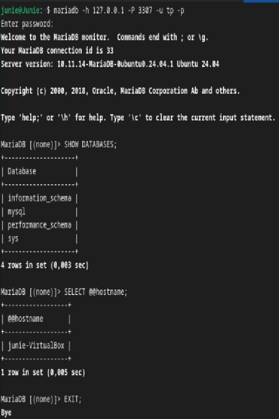

*Figure 16 : Connexion à la base de données du serveur à travers le tunnel*

## Conclusion

Ce TP nous a permis de mettre en place le protocole SSH et d'en tester plusieurs usages. Nous avons installé un serveur SSH sur Ubuntu et nous nous sommes connectés à distance depuis un client Debian, avec une communication entièrement chiffrée. Nous avons ensuite configuré l'authentification par clé, en retenant que la clé publique doit être placée dans le fichier `authorized_keys` de la machine à laquelle on se connecte, tandis que la clé privée reste sur la machine qui se connecte. Enfin, les tunnels SSH nous ont permis d'accéder à une page web (Apache) et à une base de données (MariaDB) du serveur à travers une connexion chiffrée, ce qui montre que SSH ne sert pas seulement à ouvrir un terminal à distance, il protège aussi d'autres services.
